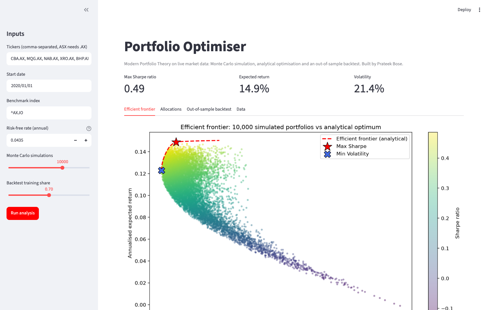
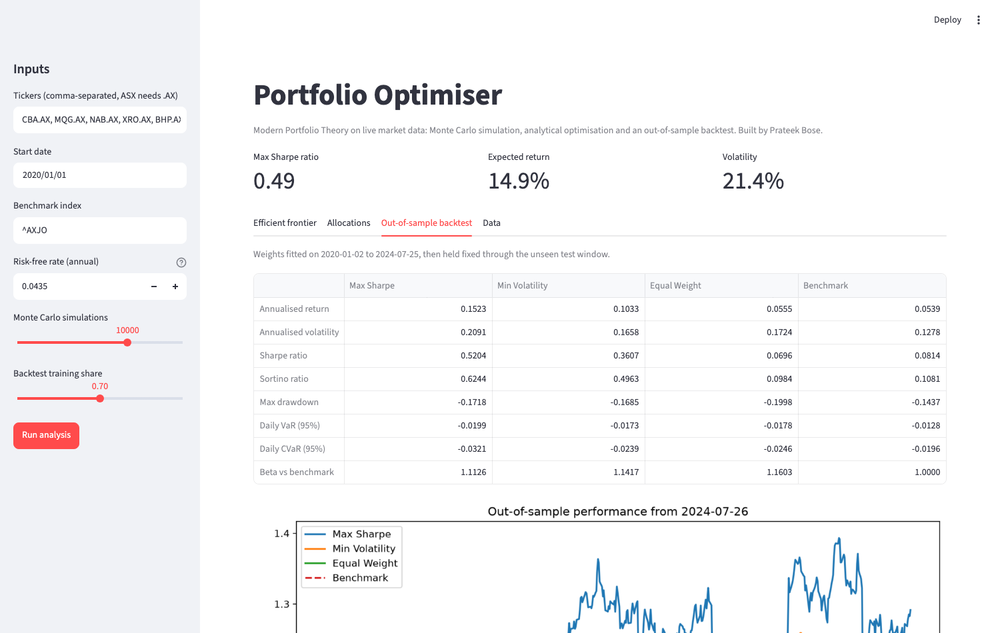

# Investment Portfolio Optimisation

**Modern Portfolio Theory on live market data: Monte Carlo simulation, analytical optimisation and an honest out-of-sample backtest.**


Give it any set of tickers (ASX, US, ETFs, anything Yahoo Finance covers) and it constructs the optimal long-only portfolio, maps the efficient frontier, and then answers the question most portfolio projects skip: **would these weights actually have worked on data the optimiser never saw?**

## What it does

1. **Fetches live prices** for any tickers over any date range (`yfinance`).
2. **Maps the feasible space** with 10,000 Monte Carlo simulated portfolios.
3. **Solves for the exact optimum** with constrained optimisation (SciPy SLSQP): the maximum-Sharpe (tangency) and minimum-volatility portfolios, plus the full analytical efficient frontier. Random sampling illustrates the space; the optimiser finds the answer.
4. **Uses a proper Sharpe ratio**: excess return over a configurable risk-free rate (default 4.35%, the RBA cash rate).
5. **Backtests out of sample**: weights are fitted on the first 70% of history, then held fixed through the unseen 30%, and compared against an equal-weight portfolio and a market benchmark (default ASX 200, `^AXJO`).
6. **Reports full risk metrics**: Sharpe, Sortino, maximum drawdown, historical VaR and CVaR (95%), and beta against the benchmark.
7. **Writes everything up automatically**: a markdown results report with charts and a conclusion, plus an Excel workbook.

## Results

The generated report, with the current numbers, charts and conclusion, lives at **[docs/results/RESULTS.md](docs/results/RESULTS.md)**. Regenerate it on today's data any time with one command:

```bash
python run_analysis.py
```

Key artefacts:

| Output | What it shows |
| --- | --- |
| `docs/results/RESULTS.md` | Full write-up: parameters, optimal weights, backtest table, conclusion |
| `docs/results/charts/efficient_frontier.png` | Monte Carlo cloud vs the analytical frontier, optima marked |
| `docs/results/charts/backtest.png` | Out-of-sample growth of $1 vs equal weight and the ASX 200 |
| `docs/results/portfolio_results.xlsx` | All simulations, weights and metrics |

## Quick start

```bash
pip install -r requirements.txt

# Default: five ASX large caps vs the ASX 200
python run_analysis.py

# Any stocks you choose, live to today
python run_analysis.py --tickers CSL.AX WES.AX TLS.AX WOW.AX --start 2019-01-01

# US portfolio against the S&P 500, custom risk-free rate
python run_analysis.py --tickers AAPL MSFT NVDA JPM --benchmark ^GSPC --rf 0.043
```

### Interactive app

```bash
streamlit run app.py
```

Type any tickers in the sidebar and explore the frontier, allocations and backtest live.





### Tests

```bash
pytest tests/ -v
```

Ten unit tests run on synthetic data (no network), including the invariant that the analytical optimiser can never lose to random sampling. They run in CI on every push.

## Project structure

```
portfolio_optimiser/
├── data.py           # Price retrieval, log returns, train/test split
├── metrics.py        # Sharpe, Sortino, drawdown, VaR/CVaR, beta
├── optimisation.py   # Monte Carlo + SLSQP max-Sharpe / min-vol / frontier
├── backtest.py       # Out-of-sample evaluation vs equal weight and benchmark
├── plots.py          # All charts (shared by the CLI and the app)
└── report.py         # Auto-generated RESULTS.md
run_analysis.py       # CLI entry point
app.py                # Streamlit app
tests/test_core.py    # Unit tests (synthetic data)
```

## Methodology notes

- **Returns**: daily log returns, annualised with 252 trading days. Log returns are summed for portfolio aggregation, a standard approximation.
- **Optimisation**: long-only, fully invested (weights in [0, 1], summing to 1). The frontier is traced by minimising volatility at each target return.
- **Why both Monte Carlo and SLSQP**: with 5 assets, the best of 10,000 random portfolios typically lands a few basis points of Sharpe below the true optimum; the gap is reported in the results. The cloud is kept because it shows *where the frontier comes from*.
- **Backtest honesty**: a single chronological split, buy-and-hold, no transaction costs. In-sample statistics always flatter, which is exactly why the report leads with out-of-sample numbers.

## Limitations and further work

Mean-variance weights are estimates built on noisy expected returns, so they concentrate in whatever did well historically; the min-volatility portfolio usually transfers out of sample better than max-Sharpe. Natural extensions: walk-forward validation, Ledoit-Wolf covariance shrinkage, transaction costs and periodic rebalancing, and Black-Litterman views.

## Author

**Prateek Bose**
Master of Management (Finance), University of Melbourne | CFA Level I candidate
[github.com/prateekbose05](https://github.com/prateekbose05)
