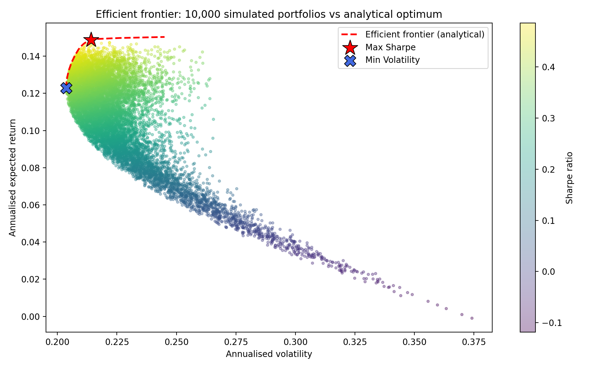
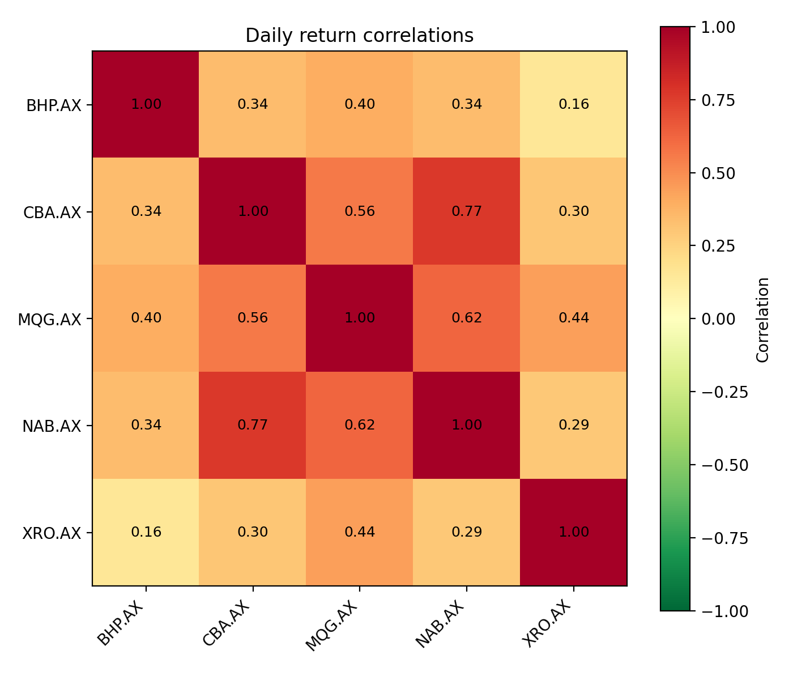

# Results

*Generated 2026-11-17 on live Yahoo Finance data.*

## Run parameters

- Tickers: BHP.AX, CBA.AX, MQG.AX, NAB.AX, XRO.AX
- History: 2020-01-01 to 2026-07-11
- Risk-free rate: 4.35% (RBA cash rate, configurable)
- Benchmark: ^AXJO
- Monte Carlo simulations: 10,000
- Train window: 2020-01-02 to 2024-07-25 (70%), test window: 2024-07-26 to 2026-07-10

## Optimal portfolios (in-sample, full history)

Maximum-Sharpe portfolio: expected return 14.87%, volatility 21.41%, Sharpe 0.49.

|        |   Max Sharpe (%) |   Min Volatility (%) |
|:-------|-----------------:|---------------------:|
| CBA.AX |            62.41 |                31.03 |
| BHP.AX |            36.31 |                30.56 |
| MQG.AX |             1.28 |                 6.36 |
| NAB.AX |             0    |                20.89 |
| XRO.AX |             0    |                11.15 |

The analytical (SLSQP) optimum had a Sharpe ratio of 0.4914 against 0.4862 for the best of 10,000 random portfolios, which is why the Monte Carlo cloud is used to map the feasible space while the exact weights come from the optimiser.

## Out-of-sample backtest

Weights were fitted on the training window only, then held fixed (buy and hold) through the unseen test window, with no trading costs.

Weights held in the backtest (fitted on the training window, so they differ from the full-history optimum above):

|        |   Max Sharpe (%) |   Min Volatility (%) |   Equal Weight (%) |
|:-------|-----------------:|---------------------:|-------------------:|
| CBA.AX |            84.68 |                35.56 |                 20 |
| BHP.AX |            12.39 |                29.47 |                 20 |
| NAB.AX |             1.7  |                18.75 |                 20 |
| XRO.AX |             1.23 |                11.22 |                 20 |
| MQG.AX |             0    |                 4.99 |                 20 |

|                       | Max Sharpe   | Min Volatility   | Equal Weight   | Benchmark   |
|:----------------------|:-------------|:-----------------|:---------------|:------------|
| Annualised return     | 15.23%       | 10.33%           | 5.55%          | 5.39%       |
| Annualised volatility | 20.91%       | 16.58%           | 17.24%         | 12.78%      |
| Sharpe ratio          | 0.52         | 0.36             | 0.07           | 0.08        |
| Sortino ratio         | 0.62         | 0.50             | 0.10           | 0.11        |
| Max drawdown          | -16.26%      | -16.57%          | -19.70%        | -14.17%     |
| Daily VaR (95%)       | -1.99%       | -1.73%           | -1.78%         | -1.28%      |
| Daily CVaR (95%)      | -3.21%       | -2.39%           | -2.46%         | -1.96%      |
| Beta vs benchmark     | 1.11         | 1.14             | 1.16           | 1.00        |

## Rebalancing and transaction costs

The backtest above holds the fitted weights fixed and trades for free. Here each portfolio is bought on the first day of the test window and simulated on its actual holdings, paying 10 basis points on every dollar bought or sold (including the initial purchase). Left alone, weights drift with prices; rebalancing trades them back to target at each month or quarter end.

| Strategy       | Rebalance   | Gross return   | Net return   | Cost drag   | Net Sharpe   | Annual turnover   | Rebalances   | Max weight drift   |
|:---------------|:------------|:---------------|:-------------|:------------|:-------------|:------------------|:-------------|:-------------------|
| Max Sharpe     | never       | 15.47%         | 15.42%       | 0.05%       | 0.52         | 0.00%             | 0            | 4.77%              |
| Max Sharpe     | quarterly   | 16.05%         | 15.98%       | 0.07%       | 0.56         | 7.13%             | 8            | 3.56%              |
| Max Sharpe     | monthly     | 15.93%         | 15.85%       | 0.07%       | 0.55         | 11.23%            | 24           | 3.21%              |
| Min Volatility | never       | 12.17%         | 12.12%       | 0.05%       | 0.46         | 0.00%             | 0            | 9.24%              |
| Min Volatility | quarterly   | 12.58%         | 12.49%       | 0.08%       | 0.49         | 16.57%            | 8            | 6.18%              |
| Min Volatility | monthly     | 12.07%         | 11.97%       | 0.10%       | 0.46         | 24.71%            | 24           | 4.89%              |
| Equal Weight   | never       | 8.36%          | 8.31%        | 0.05%       | 0.23         | 0.00%             | 0            | 11.50%             |
| Equal Weight   | quarterly   | 8.11%          | 8.03%        | 0.09%       | 0.22         | 17.53%            | 8            | 7.69%              |
| Equal Weight   | monthly     | 7.42%          | 7.32%        | 0.10%       | 0.17         | 25.82%            | 24           | 5.12%              |

For the max-Sharpe portfolio, the best net return came from **quarterly rebalancing** (15.98% a year after costs). Never rebalancing cost 0.05% a year and let one holding drift as far as 4.8 points from its target weight; monthly rebalancing turned over 11.23% of the portfolio a year and cost 0.07%.

Turnover is one-way (selling 5% to buy 5% is 5%). Gross returns differ by frequency because rebalancing changes what is held, not only what is paid: it sells winners and buys laggards, which helps when prices mean-revert and hurts when they trend.

## Conclusion

On the test window, the strongest risk-adjusted performer was the Max Sharpe portfolio (Sharpe 0.52). Out of sample, the max-Sharpe portfolio outperformed the benchmark by 9.84% annualised.

The wider takeaway matches the literature: in-sample mean-variance weights are estimates, not guarantees. Expected returns are noisy, so optimised weights can concentrate in whatever happened to do well historically, and out-of-sample results routinely narrow the gap to naive equal weighting. The minimum-volatility portfolio, which depends only on the covariance matrix, tends to transfer out of sample more reliably than the max-Sharpe portfolio.

## Limitations

- Long-only and fully invested. Trading costs are a flat rate per dollar traded: no bid-ask spread model, market impact, minimum brokerage or tax.
- Historical returns and covariances are weak predictors of future ones.
- Single train/test split rather than walk-forward validation.
- The headline backtest sums weighted log returns, a standard approximation; the cost study compounds simple returns on actual holdings.
