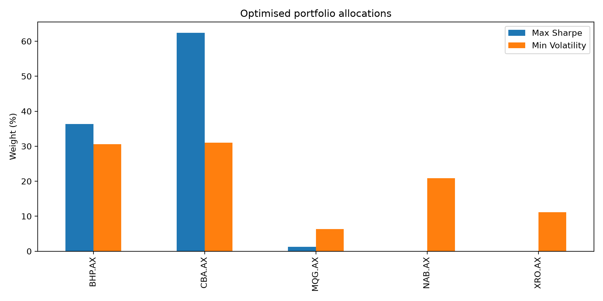
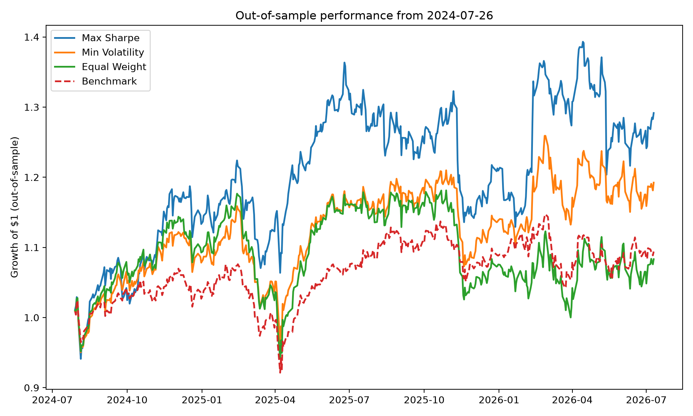

# Results

*Generated 2026-07-11 on live Yahoo Finance data.*

## Run parameters

- Tickers: BHP.AX, CBA.AX, MQG.AX, NAB.AX, XRO.AX
- History: 2020-01-01 to 2026-07-11
- Risk-free rate: 4.35% (RBA cash rate, configurable)
- Benchmark: ^AXJO
- Monte Carlo simulations: 10,000
- Train window: 2020-01-02 to 2024-07-25 (70%), test window: 2024-07-26 to 2026-07-10

## Optimal portfolios (in-sample, full history)

Maximum-Sharpe portfolio: expected return 14.87%, volatility 21.41%, Sharpe 0.49.

|        |   Max Sharpe (%) |   Min Volatility (%) |
|:-------|-----------------:|---------------------:|
| CBA.AX |            62.41 |                31.03 |
| BHP.AX |            36.31 |                30.56 |
| MQG.AX |             1.28 |                 6.36 |
| XRO.AX |             0    |                11.15 |
| NAB.AX |             0    |                20.89 |

The analytical (SLSQP) optimum had a Sharpe ratio of 0.4914 against 0.4862 for the best of 10,000 random portfolios, which is why the Monte Carlo cloud is used to map the feasible space while the exact weights come from the optimiser.

## Out-of-sample backtest

Weights were fitted on the training window only, then held fixed (buy and hold) through the unseen test window.

|                       | Max Sharpe   | Min Volatility   | Equal Weight   | Benchmark   |
|:----------------------|:-------------|:-----------------|:---------------|:------------|
| Annualised return     | 15.23%       | 10.33%           | 5.55%          | 5.39%       |
| Annualised volatility | 20.91%       | 16.58%           | 17.24%         | 12.78%      |
| Sharpe ratio          | 0.52         | 0.36             | 0.07           | 0.08        |
| Sortino ratio         | 0.62         | 0.50             | 0.10           | 0.11        |
| Max drawdown          | -17.18%      | -16.85%          | -19.98%        | -14.37%     |
| Daily VaR (95%)       | -1.99%       | -1.73%           | -1.78%         | -1.28%      |
| Daily CVaR (95%)      | -3.21%       | -2.39%           | -2.46%         | -1.96%      |
| Beta vs benchmark     | 1.11         | 1.14             | 1.16           | 1.00        |

## Conclusion

On the test window, the strongest risk-adjusted performer was the Max Sharpe portfolio (Sharpe 0.52). Out of sample, the max-Sharpe portfolio outperformed the benchmark by 9.84% annualised.

The wider takeaway matches the literature: in-sample mean-variance weights are estimates, not guarantees. Expected returns are noisy, so optimised weights can concentrate in whatever happened to do well historically, and out-of-sample results routinely narrow the gap to naive equal weighting. The minimum-volatility portfolio, which depends only on the covariance matrix, tends to transfer out of sample more reliably than the max-Sharpe portfolio.

## Limitations

- Long-only, fully invested, no transaction costs, taxes or rebalancing.
- Historical returns and covariances are weak predictors of future ones.
- Single train/test split rather than walk-forward validation.
- Log returns are summed for portfolio aggregation, a standard approximation.
